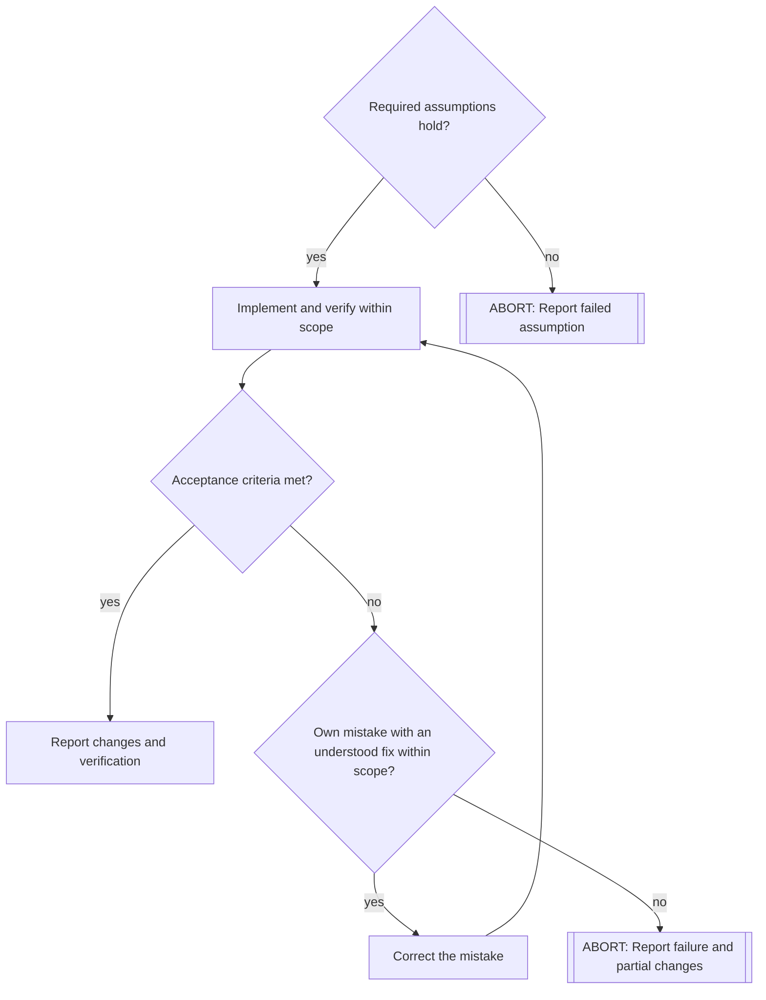

# Schedule a burn

## Size the burn

- Give each burn one bounded outcome that a pilot can implement and verify with the supplied context.
- Keep related implementation changes, necessary tests, and self-review together.
- Split independent outcomes or work that requires substantially different context.
- Resolve open design decisions before scheduling implementation.

## Prepare the plan

1. Supply the goal, scope limits, relevant context, acceptance criteria, and required checks.
2. Include the checks and review required by the waypoint rules, using project verification commands.
3. Draw a Mermaid flowchart with the main steps and meaningful decision points.

Show abort paths for failed assumptions, scope changes, and failures that require broader investigation.
Allow correction of the pilot's own mistakes within scope. Avoid a decision diamond after every routine action.
Keep the diagram focused on implementation. Do not repeat all instructions in its nodes.

Pass the diagram through stdin:

````sh
orbit burn schedule <orbit-id> <waypoint> "<description>" "<instructions>" --context "<context>" <<'EOF'

EOF
````

Replace the example with task-specific conditions. Then delegate to `pilot` with the returned burn number:

```yaml
---
orbit-id: <orbit-id>
burn-number: <burn-number>
---
```

The pilot loads the plan with `orbit burn initiate`.
Handle the result according to the Orbit rules.
